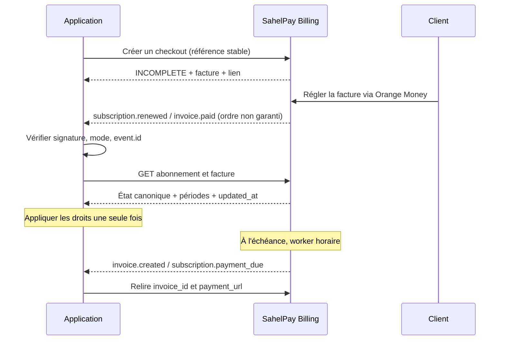

<Tabs>
<Tab title="Français">

## Contrat Billing — SDK 1.3.0 — cycle de vie, rejeu et pagination

Billing facture **vos clients** ; il ne conditionne pas votre accès marchand à SahelPay.
Tous les SDK 1.3.0 utilisent `/v1/billing/*`. Orange Money Mali/XOF est le seul moyen
intégré, chaque règlement exige une action du client : **aucun prélèvement automatique**.

Un plan définit un montant et une fréquence `WEEKLY`, `MONTHLY`, `QUARTERLY` ou `YEARLY`.
Un abonnement porte une identité client et des périodes ISO UTC. Une facture porte
le montant à régler et son lien de paiement. Utilisez une clé de la même application
et du même mode pour toutes les opérations d'un cycle.

## Identité sans téléphone

La création accepte au moins une identité : `customer_id`, `customer_external_ref`,
`customer_email` ou `customer_phone`. `customer_name` est facultatif. Le téléphone
peut être absent ou `null` dans les réponses ; ne le remplacez jamais par un numéro
inventé. Les profils sont créés par les parcours d'abonnement/portail ; l'API clients
expose la liste, sans CRUD direct. `external_ref` est unique dans l'application.

`customer_external_ref` identifie votre utilisateur ; `external_ref` identifie
l'opération d'abonnement. Avec `external_ref` sur `with-payment`, fournissez
`customer_external_ref` et omettez `customer_id` et `customer_phone`. L'import suit
la même règle et exige une clé API d'application. Les profils clients restent
partagés entre TEST et LIVE : utilisez des références de test distinctes.

## Parcours en mode TEST

Utilisez le SDK **1.3.0**. Vérifiez `npm view @sahelpay/sdk version` : si le registre
propose 1.3.0, installez `npm install @sahelpay/sdk@^1.3.0`. Si npm est encore à
1.1.0, installez les sources taguées en attendant la publication :

```bash
git clone --branch javascript-v1.3.0 https://github.com/dione24/sahelpay-sdks.git
cd sahelpay-sdks/javascript
npm ci
npm run build
# Dans votre application : npm install /chemin/vers/sahelpay-sdks/javascript
```

Fournissez une clé TEST dans `SAHELPAY_SECRET_KEY`. Les exemples ci-dessous ne contiennent aucune vraie clé,
aucun téléphone et n'envoient aucun message au client.

```typescript
import SahelPay from '@sahelpay/sdk';
const api = new SahelPay({ secretKey: process.env.SAHELPAY_SECRET_KEY! });
const plan = await api.plans.create({
  name: 'Premium TEST', amount: 4000, interval: 'MONTHLY',
});
const checkout = await api.subscriptions.createWithPayment({
  plan_id: plan.id,
  customer_external_ref: 'test_user_PLACEHOLDER',
  external_ref: 'test_checkout_PLACEHOLDER',
  idempotency_key: 'test_checkout_PLACEHOLDER',
  redirect_url: 'https://merchant.example/billing',
});
const canonical = await api.subscriptions.retrieve(checkout.subscription.id);
const invoice = checkout.invoice && await api.invoices.retrieve(checkout.invoice.id);
// Vérifiez canonical.livemode === false et invoice?.livemode === false.
// checkout.payment_link?.url est le lien hébergé de la facture.
```

Pour un **essai**, ajoutez `trial_end` (date ISO UTC future) à `createWithPayment`.
La réponse est `ACTIVE`, avec `invoice: null` et `payment_link: null`. La première
facture sera préparée à la fin de l'essai par le worker horaire. `create()` accepte
`start_date` et `trial_end`, mais ne produit pas de lien immédiat.

Pour vérifier un paiement sans opérateur ni personne réelle, utilisez le
[simulateur SahelPay](/guides/testing) avec une clé TEST, `mock: true`, montant
`4000`, `hosted_checkout: false`. Un paiement simulé indépendant ne règle pas
à lui seul votre facture Billing : ne déduisez jamais les droits d'un simple
`payment.success`. Les fixtures du dépôt rejouent hors réseau essais, factures,
signatures, doublons et réponses de reprise. Aucun test clock public n'est promis.
`webhook.test` vérifie la connectivité, pas le cycle Billing.

## Périodes payées, essais et impayés (backend #214)

Relisez le GET canonique avant d’accorder les droits : ses états sont calculés
à l’heure de lecture, même lorsque le passage horaire a du retard.

| État / champ | Sens |
| --- | --- |
| `INCOMPLETE` | Premier paiement attendu, aucune période payée |
| `ACTIVE` canonique | Période payée courante, ou période explicitement importée comme payée |
| `TRIALING` canonique | Essai explicite courant |
| `PAST_DUE` | Facture encore payable, y compris après expiration des droits |
| `access_status` | Droits ; `EXPIRED` à la fin de la grâce payée ou de l’essai |
| `grace_until` | Fin de période payée + trois jours ; null après essai ou sans période payée |
| `CANCELLED` | Annulation immédiate, aucun accès réactivé par un paiement tardif |
| `billing_anchor_at` | Ancre UTC conservée au renouvellement dans la grâce |

La réponse historique de création d’essai reste `ACTIVE` avec `trial_end` ; son
GET canonique renvoie `TRIALING`. La création sans essai et sans paiement est
`INCOMPLETE`. Un paiement partiel ne prolonge pas les droits. Reçu, facture PAID
et période sont écrits atomiquement ; le rejeu n’accorde pas de seconde période.

Le premier paiement complet et le paiement après la grâce accordent un intervalle
entier depuis le règlement, sans arriérés. Dans la grâce, le renouvellement garde
l’échéance et l’ancre UTC : 31 janvier → 28/29 février → 31 mars. Même règle pour
le trimestre et l’année. L’import accepte une ancre historique `billing_anchor_at`
antérieure ou égale au début de période ; les deux bornes importées restent exactes.

`status` reste `PAST_DUE` après la grâce pour permettre le règlement de la même
facture ; utilisez `access_status` et les dates pour les droits. Le passage du temps
ne change pas `updated_at` : planifiez une relecture à la fin de période/grâce,
en plus des signaux webhook. Les champs ajoutés sont facultatifs dans les types
SDK pour permettre la lecture d’une ancienne version du backend.

## Reprise, idempotence et pagination

Les six créations Billing (`plans.create`, `subscriptions.create`, checkout, import,
`plans.sendLink`, `invoices.create`) acceptent `idempotency_key` : en-tête
`X-Idempotency-Key` de 1 à 128 caractères, jamais dans le JSON. Le backend réserve
l'identité avant la création et conserve la clé sans expiration. Même portée
marchand/application/mode/route et même JSON (ordre des propriétés indifférent) :
même ressource. Corps différent : `409 IDEMPOTENCY_KEY_REUSED` ; clé invalide :
`400 INVALID_IDEMPOTENCY_KEY`. Gardez la clé stable lors des reprises réseau.
Le rejeu renvoie l'état **actuel**, pas une copie de la première réponse.

Sans en-tête, les garanties précédentes subsistent : `external_ref` déduplique
checkout/import, les autres créations ne sont pas dédupliquées. Une référence de
checkout exige `customer_external_ref`, sans ID/téléphone. Après règlement ou
annulation de la facture, checkout et `plans.sendLink` peuvent renvoyer un lien
`null` ; `sendLink` ajoute alors `invoice_status`. Aucun nouvel encaissement n'est
créé. Renouvelez via `invoice_id`/`payment_url` du GET canonique.

`subscriptions.import()` (Python : `import_period`, PHP : `importPeriod`) reprend
une période **courante** avec `plan_id`, `external_ref`, `customer_external_ref`,
`current_period_start`, `current_period_end`. `trial_end`, si fourni, doit être égal
à la fin de période. Aucun paiement, facture ou message n'est créé par l'import.

| Ressource | Méthodes JS | Pagination |
| --- | --- | --- |
| Plans | `create`, `list`, `listPage`, `update`, `deactivate`, `delete`, `sendLink` | `take/cursor` ; `list()` conserve son tableau, `listPage()` expose la pagination |
| Clients | `customers.list({search, page, limit, take, cursor})` | `customers`, pagination par curseur et anciens champs page/limit/pages |
| Abonnements | `create`, `createWithPayment`, `retrieve`, `import`, `list`, `cancel` | `status`, `take/cursor` ; `{subscriptions, pagination}` |
| Factures | `create`, `list`, `retrieve`, `open`, `void`, `generatePaymentLink` | `take/cursor` ou `limit/offset` ; SDK JS/Python : `{invoices, pagination}` |

Toutes les listes acceptent `take` entre 1 et 200 (défaut 50, clients 20), et un
`cursor` opaque. La pagination contient `total`, `take`, `next_cursor` nullable et
`has_more`. Réutilisez le curseur avec les mêmes filtres, application et mode ;
`total` compte tous les résultats filtrés avant le curseur. L'ordre est
`created_at DESC, id DESC`. La page suivante n'insère pas les objets plus récents ;
un curseur reste utilisable après suppression de sa ligne.

```typescript
let cursor: string | undefined;
do {
  const page = await api.plans.listPage({ take: 50, cursor });
  // Traitez page.plans ; list() continue à renvoyer un tableau.
  cursor = page.pagination?.has_more ? page.pagination.next_cursor ?? undefined : undefined;
} while (cursor);
```

Python expose `plans.list_page()` pour les métadonnées ; `plans.list()` garde sa
liste. Les nouveaux champs de pagination sont facultatifs pour lire les anciens
serveurs. En PHP, les factures sont dans
`getData()` et la pagination dans `getRawData()['pagination']`. Les noms de méthodes
Python utilisent snake_case, PHP utilise `all()` pour les listes.

## Webhooks : vérifier, dédupliquer, relire



```typescript
// rawBody = corps brut, avant tout JSON.parse ou re-sérialisation.
const event = api.webhooks.constructEvent(
  rawBody, signatureHeader, process.env.SAHELPAY_WEBHOOK_SECRET!,
);
if (event.livemode !== false) throw new Error('Mode inattendu pour ce test');
if (event.event === 'subscription.payment_due') {
  const subscription = await api.subscriptions.retrieve(event.data.subscription_id);
  // Dédupliquez event.id dans votre base et comparez subscription.updated_at.
  // Utilisez le lien canonique ; ne supposez jamais un téléphone disponible.
}
```

Signature : `X-SahelPay-Signature: t=TIMESTAMP,v1=HMAC_HEX`, HMAC-SHA256 sur
`timestamp + '.' + corps_brut`, tolérance par défaut 300 secondes. Les trois SDK
vérifient la signature et rejettent les corps modifiés ou trop anciens. Les événements
sont des **signaux de relecture**, pas une preuve suffisante de paiement. Dédupliquez
sur `event.id`, supportez le désordre et ignorez les événements inconnus.

| Événement | Charge utile principale |
| --- | --- |
| `invoice.created` | `invoice_id`, `subscription_id`, `amount_due`, `payment_url`, `due_date` |
| `subscription.payment_due` | Même échéance, avec `billing_date` ; compatibilité, éviter un double envoi |
| `invoice.paid` | `invoice_id`, `subscription_id`, `amount_paid`, `amount_due`, `status` |
| `subscription.renewed` | `subscription_id`, `next_billing_date`, `invoice_id`, `current_period_start/end`, `updated_at`, `billing_anchor_at` |
| `subscription.cancelled` | Annulation immédiate ; `subscription_id`, `plan_id`, `status`, `updated_at`, `current_period_start/end` ; même event.id au rejeu |

`cancel()` émet `subscription.cancelled` avec un event.id stable. Si votre
endpoint filtre les événements, abonnez-le explicitement à ce type, puis relisez
le GET canonique. La relecture après l’appel et le polling restent disponibles.
Les relances e-mail restent pilotées par le backend ; le SDK n'active aucun envoi.

## Erreurs

| HTTP / code | Action |
| --- | --- |
| `400` / `VALIDATION_ERROR`, `BAD_REQUEST` | Vérifier identité, dates ISO UTC, période importée courante et plan actif |
| `401` / `INVALID_API_KEY` | Vérifier la clé serveur et son mode |
| `404` / `NOT_FOUND` | Ressource absente ou hors application/mode ; ne pas réessayer avec une clé d'un autre périmètre |
| `409` / `CONFLICT` | Référence externe déjà utilisée avec d'autres paramètres |
| `409` / `INVOICE_PAYMENT_SETTLEMENT_PENDING` | Un paiement a réussi ; le backend reprend son règlement. Ne pas payer à nouveau : relire le paiement et la facture, puis le GET canonique de l’abonnement |
| `429` | Respecter la limitation et réessayer avec la même référence |
| Timeout réseau | Relire la ressource ; rejouer seulement avec une garantie d'idempotence applicable |

Les messages exacts peuvent varier selon la validation. Voir les [codes d'erreur](/resources/error-codes)
et les [types et versions SDK](/sdks/overview).

</Tab>
<Tab title="English">

## Billing contract — SDK 1.3.0 — lifecycle and persistent replay

Billing manages **your customers' subscriptions**, separately from merchant access
to SahelPay. All three SDKs use `/v1/billing/*`. Orange Money Mali/XOF requires the
customer to confirm each payment; there is no automatic debit.

Plans support `WEEKLY`, `MONTHLY`, `QUARTERLY`, `YEARLY`. Supply at least one of
`customer_id`, `customer_external_ref`, `customer_email`, `customer_phone`; phone is
optional and can be `null` in responses. Customer profiles are created by subscription
or portal flows, with list-only customer access. Keep application and TEST/LIVE mode
consistent. Customer profiles are shared across modes: use distinct test references.

```typescript
import SahelPay from '@sahelpay/sdk';
const api = new SahelPay({ secretKey: process.env.SAHELPAY_SECRET_KEY! });
const plan = await api.plans.create({name:'Premium TEST',amount:4000,interval:'MONTHLY'});
const result = await api.subscriptions.createWithPayment({
  plan_id: plan.id,
  customer_external_ref: 'test_user_PLACEHOLDER',
  external_ref: 'test_checkout_PLACEHOLDER',
  idempotency_key: 'test_checkout_PLACEHOLDER',
});
const current = await api.subscriptions.retrieve(result.subscription.id);
```

Use SDK 1.3.0 and a TEST application key. Check `npm view @sahelpay/sdk version`
before installing `@sahelpay/sdk@^1.3.0`. If npm still serves 1.1.0, clone tag
`javascript-v1.3.0`, run `npm ci && npm run build` inside `javascript`, and install that
local directory into your application until registry publication is available.
These examples contain no real phone or customer email.
For a trial, add a future ISO UTC `trial_end`: status is `ACTIVE`, while `invoice` and
`payment_link` are `null`. The hourly worker prepares the invoice when the trial ends.
`create()` also supports `start_date` and does not create an immediate checkout.

**Canonical lifecycle (backend #214).** `ACTIVE` means a current paid or explicitly
imported paid period; `TRIALING` means an explicit trial. The historical trial
creation response still says `ACTIVE` with `trial_end`: retrieve the canonical
snapshot before granting access. Unpaid creation is `INCOMPLETE`. Paid access has
three days of grace anchored to `current_period_end`; a trial has no grace.
`access_status` becomes `EXPIRED`, while `status` stays collectable `PAST_DUE` so
the same invoice can still be paid. Cancellation wins over any late payment.

Receipt, invoice and subscription period commit atomically. Partial payment grants
no paid period; replay never grants a second one. First payment and payment after
grace start one full interval at settlement, without arrears. During grace, retain
the UTC calendar anchor: Jan 31 → Feb 28/29 → Mar 31. Imports optionally accept
`billing_anchor_at` no later than period start. New SDK fields remain optional for
older servers. Time alone does not change `updated_at`: schedule reads at period
and grace boundaries. Subscribe explicitly to `subscription.cancelled` if your
endpoint filters event types; its event ID is stable on cancellation replay.

All six Billing creation helpers send `idempotency_key` as `X-Idempotency-Key`
(1–128 characters), never JSON. The server reserves the identity before creation
and retains it without expiry. Same merchant/application/mode/route and JSON body
(property order ignored): same resource. A changed body returns
`409 IDEMPOTENCY_KEY_REUSED`; invalid keys return `400 INVALID_IDEMPOTENCY_KEY`.
Replay returns current state. Without a header, only checkout/import retain their
natural `external_ref` replay guarantee. Completed/voided checkout or send-link
replays can return a null link; send-link adds `invoice_status`. Renew using the
canonical GET's `invoice_id`/`payment_url`, not a new checkout.

Import a current period with `subscriptions.import()` (Python `import_period`, PHP
`importPeriod`), `external_ref`, `customer_external_ref`, `plan_id` and both period
bounds. An explicit `trial_end` must equal the period end. An application API key is
required; import creates no payment, invoice or notification.

All lists accept `take` (1–200; default 50, customers 20) and an opaque `cursor`.
Pagination exposes `total`, `take`, nullable `next_cursor` and `has_more`. Reuse the
same filters, application and mode. Order is `created_at DESC, id DESC`; `total`
counts all filtered rows before the cursor. Newer objects do not enter later pages,
and deleting the cursor row does not invalidate the cursor. Customer `page/limit`
and invoice `limit/offset` options remain available. JS `plans.list()` still returns
an array; use `plans.listPage()` (Python `list_page`) for `{plans,pagination}`.
Subscriptions/customers keep pagination inside `data`; invoices/plans expose it
outside `data`. PHP uses `getRawData()['pagination']` for those outer envelopes.
New cursor metadata is optional in SDK types for older servers.

The lifecycle diagram in the French tab applies to both languages: checkout → manual
payment → `subscription.renewed` / `invoice.paid` → canonical GET; at each due date,
`invoice.created` and compatibility `subscription.payment_due` signal the new invoice.
Verify HMAC-SHA256 on `timestamp + '.' + raw_body` using `X-SahelPay-Signature`, default
300-second tolerance. Automatic retries use 1/2/4/8-minute delays; endpoint secret
rotation is immediate, with no grace period for the old secret. Use `webhooks.constructEvent` (Python `construct_event`, PHP
`constructEvent`), deduplicate `event.id`, validate `livemode`, re-read canonical state
and compare `updated_at`. Delivery order is not guaranteed. Ignore unknown event names.
Cancellation emits subscription.cancelled with a stable event ID. Explicitly
subscribe to this type when your endpoint filters events, then retrieve canonical
state. Reads after cancellation and polling remain available. Reminders stay
backend controlled; no SDK call enables sending.

For offline tests, use the repository's Billing response/signature fixtures. For an
operator-free payment test, use a TEST key and the [simulator](/guides/testing) with
`mock:true`, amount `4000`, `hosted_checkout:false`. An unrelated simulated payment
alone does not settle a Billing invoice. `webhook.test` checks connectivity only.

Errors: 400 validation/invalid identity or dates; 401 invalid key; 404 missing or
out-of-scope resource; 409 conflicting reference; 429 rate limit. On network timeout,
retrieve the resource or replay only with a supported idempotency guarantee.
`409 INVOICE_PAYMENT_SETTLEMENT_PENDING` means a payment already succeeded and
the backend is recovering its settlement. Do not collect again: retrieve payment,
invoice and canonical subscription state. This also protects Sarali instructions. See
[error codes](/resources/error-codes) and [SDK installation](/sdks/overview).

</Tab>
</Tabs>
