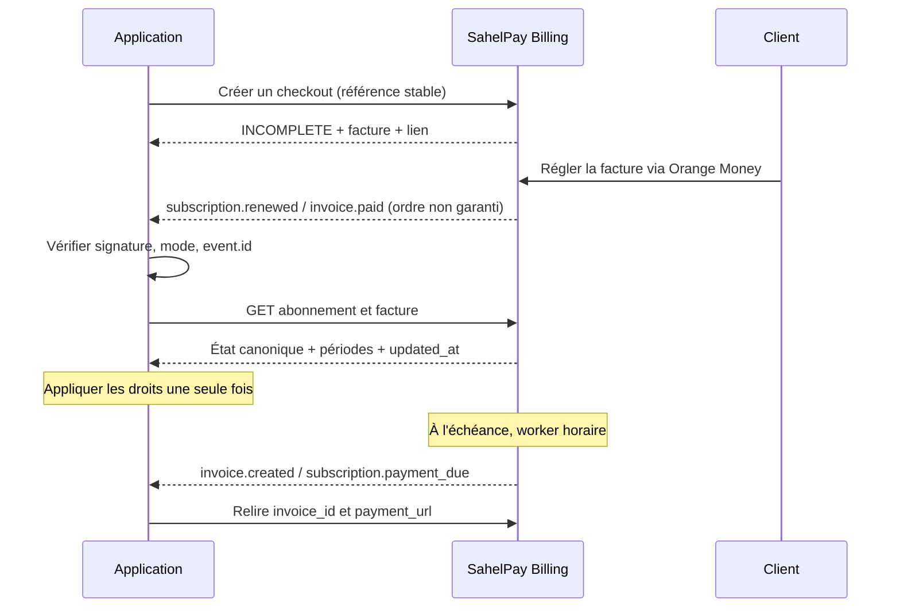

<Tabs>
<Tab title="Français">

## Contrat Billing 1.2.0

Billing facture **vos clients** ; il ne conditionne pas votre accès marchand à SahelPay.
Tous les SDK 1.2.0 utilisent `/v1/billing/*`. Orange Money Mali/XOF est le seul moyen
intégré, chaque règlement exige une action du client : **aucun prélèvement automatique**.

Un plan définit un montant et une fréquence `WEEKLY`, `MONTHLY`, `QUARTERLY` ou `YEARLY`.
Un abonnement porte une identité client et des périodes ISO UTC. Une facture porte
le montant à régler et son lien de paiement. Utilisez une clé de la même application
et du même mode pour toutes les opérations d'un cycle.

## Identité sans téléphone

La création accepte au moins une identité : `customer_id`, `customer_external_ref`,
`customer_email` ou `customer_phone`. `customer_name` est facultatif. Le téléphone
peut être absent ou `null` dans les réponses ; ne le remplacez jamais par un numéro
inventé. Les profils sont créés par les parcours d'abonnement/portail ; l'API clients
expose la liste, sans CRUD direct. `external_ref` est unique dans l'application.

`customer_external_ref` identifie votre utilisateur ; `external_ref` identifie
l'opération d'abonnement. Avec `external_ref` sur `with-payment`, fournissez
`customer_external_ref` et omettez `customer_id` et `customer_phone`. L'import suit
la même règle et exige une clé API d'application. Les profils clients restent
partagés entre TEST et LIVE : utilisez des références de test distinctes.

## Parcours en mode TEST

Utilisez le SDK **1.2.0**. Vérifiez `npm view @sahelpay/sdk version` : si le registre
propose 1.2.0, installez `npm install @sahelpay/sdk@^1.2.0`. Si npm est encore à
1.1.0, installez les sources taguées en attendant la publication :

```bash
git clone --branch javascript-v1.2.0 https://github.com/dione24/sahelpay-sdks.git
cd sahelpay-sdks/javascript
npm ci
npm run build
# Dans votre application : npm install /chemin/vers/sahelpay-sdks/javascript
```

Fournissez une clé TEST dans `SAHELPAY_SECRET_KEY`. Les exemples ci-dessous ne contiennent aucune vraie clé,
aucun téléphone et n'envoient aucun message au client.

```typescript
import SahelPay from '@sahelpay/sdk';
const api = new SahelPay({ secretKey: process.env.SAHELPAY_SECRET_KEY! });
const plan = await api.plans.create({
  name: 'Premium TEST', amount: 4000, interval: 'MONTHLY',
});
const checkout = await api.subscriptions.createWithPayment({
  plan_id: plan.id,
  customer_external_ref: 'test_user_PLACEHOLDER',
  external_ref: 'test_checkout_PLACEHOLDER',
  idempotency_key: 'test_checkout_PLACEHOLDER',
  redirect_url: 'https://merchant.example/billing',
});
const canonical = await api.subscriptions.retrieve(checkout.subscription.id);
const invoice = checkout.invoice && await api.invoices.retrieve(checkout.invoice.id);
// Vérifiez canonical.livemode === false et invoice?.livemode === false.
// checkout.payment_link?.url est le lien hébergé de la facture.
```

Pour un **essai**, ajoutez `trial_end` (date ISO UTC future) à `createWithPayment`.
La réponse est `ACTIVE`, avec `invoice: null` et `payment_link: null`. La première
facture sera préparée à la fin de l'essai par le worker horaire. `create()` accepte
`start_date` et `trial_end`, mais ne produit pas de lien immédiat.

Pour vérifier un paiement sans opérateur ni personne réelle, utilisez le
[simulateur SahelPay](/guides/testing) avec une clé TEST, `mock: true`, montant
`4000`, `hosted_checkout: false`. Un paiement simulé indépendant ne règle pas
à lui seul votre facture Billing : ne déduisez jamais les droits d'un simple
`payment.success`. Les fixtures du dépôt rejouent hors réseau essais, factures,
signatures, doublons et réponses de reprise. Aucun test clock public n'est promis.
`webhook.test` vérifie la connectivité, pas le cycle Billing.

## ACTIVE ≠ paid

| État / champ | Sens |
| --- | --- |
| `INCOMPLETE` | Premier paiement attendu, hors essai |
| `ACTIVE` | Calendrier actif ; peut être un essai, un import ou une création sans paiement |
| `PAST_DUE` | Échéance dépassée ; GET canonique expose aussi ce statut à l'expiration |
| `CANCELLED` | Annulation immédiate ; votre application décide des droits restants |
| `trial_end` | Fin de l'essai explicite ; `null` signifie aucun essai explicite |
| `current_period_start/end` | Période canonique, nullable pour les anciennes lignes |
| `next_billing_date` | Prochaine échéance, pas une preuve de règlement |

Avant d'accorder des droits payés, relisez l'abonnement et la facture correspondante :
mode/application/identité attendus, facture `PAID`, `amount_due === 0` et période
valide. Un paiement partiel ne prolonge pas l'abonnement. Les bornes peuvent être
indicatives avant règlement ; un import affirme une période existante, sans créer
un nouveau paiement. Aucune grâce de trois jours n'est garantie par l'API : la
politique d'accès appartient à votre application.

## Reprise, idempotence et pagination

Les méthodes de création acceptent `idempotency_key` et l'envoient en en-tête
`X-Idempotency-Key`, jamais dans le JSON. **Sur cette révision, la présence de cet
en-tête ne garantit pas le rejeu de toutes les créations Billing.** Pour la reprise
fiable d'un checkout, utilisez aussi `external_ref` stable + `customer_external_ref` ;
un rejeu renvoie la même ressource, des paramètres différents sont refusés (`409`).
Ne créez pas un nouveau checkout pour renouveler : relisez `payment_url` et
`invoice_id` via GET. Après un paiement ou une facture annulée, le rejeu peut
renvoyer une facture minimale et `payment_link: null`.

`subscriptions.import()` (Python : `import_period`, PHP : `importPeriod`) reprend
une période **courante** avec `plan_id`, `external_ref`, `customer_external_ref`,
`current_period_start`, `current_period_end`. `trial_end`, si fourni, doit être égal
à la fin de période. Aucun paiement, facture ou message n'est créé par l'import.

| Ressource | Méthodes JS | Pagination |
| --- | --- | --- |
| Plans | `create`, `list`, `update`, `deactivate`, `delete`, `sendLink` | Liste complète sur cette révision |
| Clients | `customers.list({search, page, limit})` | `customers`, `pagination: {page, limit, total, pages}` |
| Abonnements | `create`, `createWithPayment`, `retrieve`, `import`, `list`, `cancel` | Filtre `status`, total uniquement sur cette révision |
| Factures | `create`, `list`, `retrieve`, `open`, `void`, `generatePaymentLink` | `limit`, `offset` ; SDK JS/Python : `{invoices, pagination}` |

Les plafonds de liste clients/factures sont de 200. En PHP, les factures sont dans
`getData()` et la pagination dans `getRawData()['pagination']`. Les noms de méthodes
Python utilisent snake_case, PHP utilise `all()` pour les listes.

## Webhooks : vérifier, dédupliquer, relire



```typescript
// rawBody = corps brut, avant tout JSON.parse ou re-sérialisation.
const event = api.webhooks.constructEvent(
  rawBody, signatureHeader, process.env.SAHELPAY_WEBHOOK_SECRET!,
);
if (event.livemode !== false) throw new Error('Mode inattendu pour ce test');
if (event.event === 'subscription.payment_due') {
  const subscription = await api.subscriptions.retrieve(event.data.subscription_id);
  // Dédupliquez event.id dans votre base et comparez subscription.updated_at.
  // Utilisez le lien canonique ; ne supposez jamais un téléphone disponible.
}
```

Signature : `X-SahelPay-Signature: t=TIMESTAMP,v1=HMAC_HEX`, HMAC-SHA256 sur
`timestamp + '.' + corps_brut`, tolérance par défaut 300 secondes. Les trois SDK
vérifient la signature et rejettent les corps modifiés ou trop anciens. Les événements
sont des **signaux de relecture**, pas une preuve suffisante de paiement. Dédupliquez
sur `event.id`, supportez le désordre et ignorez les événements inconnus.

| Événement | Charge utile principale |
| --- | --- |
| `invoice.created` | `invoice_id`, `subscription_id`, `amount_due`, `payment_url`, `due_date` |
| `subscription.payment_due` | Même échéance, avec `billing_date` ; compatibilité, éviter un double envoi |
| `invoice.paid` | `invoice_id`, `subscription_id`, `amount_paid`, `amount_due`, `status` |
| `subscription.renewed` | `subscription_id`, `next_billing_date`, `invoice_id` |

Sur cette révision, `cancel()` n'émet pas de `subscription.cancelled` : relisez
l'état après votre appel et utilisez le polling pour les annulations externes.
Les relances e-mail restent pilotées par le backend ; le SDK n'active aucun envoi.

## Erreurs

| HTTP / code | Action |
| --- | --- |
| `400` / `VALIDATION_ERROR`, `BAD_REQUEST` | Vérifier identité, dates ISO UTC, période importée courante et plan actif |
| `401` / `INVALID_API_KEY` | Vérifier la clé serveur et son mode |
| `404` / `NOT_FOUND` | Ressource absente ou hors application/mode ; ne pas réessayer avec une clé d'un autre périmètre |
| `409` / `CONFLICT` | Référence externe déjà utilisée avec d'autres paramètres |
| `429` | Respecter la limitation et réessayer avec la même référence |
| Timeout réseau | Relire la ressource ; rejouer seulement avec une garantie d'idempotence applicable |

Les messages exacts peuvent varier selon la validation. Voir les [codes d'erreur](/resources/error-codes)
et les [types et versions SDK](/sdks/overview).

</Tab>
<Tab title="English">

## Billing contract 1.2.0

Billing manages **your customers' subscriptions**, separately from merchant access
to SahelPay. All three SDKs use `/v1/billing/*`. Orange Money Mali/XOF requires the
customer to confirm each payment; there is no automatic debit.

Plans support `WEEKLY`, `MONTHLY`, `QUARTERLY`, `YEARLY`. Supply at least one of
`customer_id`, `customer_external_ref`, `customer_email`, `customer_phone`; phone is
optional and can be `null` in responses. Customer profiles are created by subscription
or portal flows, with list-only customer access. Keep application and TEST/LIVE mode
consistent. Customer profiles are shared across modes: use distinct test references.

```typescript
import SahelPay from '@sahelpay/sdk';
const api = new SahelPay({ secretKey: process.env.SAHELPAY_SECRET_KEY! });
const plan = await api.plans.create({name:'Premium TEST',amount:4000,interval:'MONTHLY'});
const result = await api.subscriptions.createWithPayment({
  plan_id: plan.id,
  customer_external_ref: 'test_user_PLACEHOLDER',
  external_ref: 'test_checkout_PLACEHOLDER',
  idempotency_key: 'test_checkout_PLACEHOLDER',
});
const current = await api.subscriptions.retrieve(result.subscription.id);
```

Use SDK 1.2.0 and a TEST application key. Check `npm view @sahelpay/sdk version`
before installing `@sahelpay/sdk@^1.2.0`. If npm still serves 1.1.0, clone tag
`javascript-v1.2.0`, run `npm ci && npm run build` inside `javascript`, and install that
local directory into your application until registry publication is available.
These examples contain no real phone or customer email.
For a trial, add a future ISO UTC `trial_end`: status is `ACTIVE`, while `invoice` and
`payment_link` are `null`. The hourly worker prepares the invoice when the trial ends.
`create()` also supports `start_date` and does not create an immediate checkout.

**ACTIVE ≠ paid.** It can mean a trial, an imported period, or scheduled billing before
payment. `current_period_start/end` and `trial_end` can be null for legacy records.
`next_billing_date` is a due date, not proof of settlement. Re-read the canonical
subscription and invoice, verify identity/application/mode, require `PAID` with
`amount_due === 0` for a paid invoice and validate the period. Partial payments do not
extend the subscription. The API guarantees no three-day access grace period.
`PAST_DUE` indicates expiry; `CANCELLED` is immediate and access policy is yours.

`idempotency_key` is transmitted as `X-Idempotency-Key`, never JSON. On this revision,
the header alone does **not** guarantee replay for every Billing creation. Reuse a
stable checkout `external_ref` plus `customer_external_ref` (omit customer ID/phone in
this referenced flow). Conflicting parameters return 409. A completed/voided checkout
replay may return a minimal invoice and a null link. Renew using the canonical GET's
`invoice_id`/`payment_url`, not a new checkout.

Import a current period with `subscriptions.import()` (Python `import_period`, PHP
`importPeriod`), `external_ref`, `customer_external_ref`, `plan_id` and both period
bounds. An explicit `trial_end` must equal the period end. An application API key is
required; import creates no payment, invoice or notification.

Customers use `page/limit` and return `{customers,pagination:{page,limit,total,pages}}`.
Subscriptions currently support `status` and return `{subscriptions,pagination:{total}}`;
plans return a full list. Invoices use `limit/offset` and JS/Python return
`{invoices,pagination:{total,limit,offset}}`. PHP exposes invoice pagination via
`getRawData()['pagination']`. Customer/invoice page sizes are capped at 200.

The lifecycle diagram in the French tab applies to both languages: checkout → manual
payment → `subscription.renewed` / `invoice.paid` → canonical GET; at each due date,
`invoice.created` and compatibility `subscription.payment_due` signal the new invoice.
Verify HMAC-SHA256 on `timestamp + '.' + raw_body` using `X-SahelPay-Signature`, default
300-second tolerance. Use `webhooks.constructEvent` (Python `construct_event`, PHP
`constructEvent`), deduplicate `event.id`, validate `livemode`, re-read canonical state
and compare `updated_at`. Delivery order is not guaranteed. Ignore unknown event names.
Cancellation currently emits no lifecycle webhook: re-read or poll. Reminders are
backend controlled; no SDK call enables sending.

For offline tests, use the repository's Billing response/signature fixtures. For an
operator-free payment test, use a TEST key and the [simulator](/guides/testing) with
`mock:true`, amount `4000`, `hosted_checkout:false`. An unrelated simulated payment
alone does not settle a Billing invoice. `webhook.test` checks connectivity only.

Errors: 400 validation/invalid identity or dates; 401 invalid key; 404 missing or
out-of-scope resource; 409 conflicting reference; 429 rate limit. On network timeout,
retrieve the resource or replay only with a supported idempotency guarantee. See
[error codes](/resources/error-codes) and [SDK installation](/sdks/overview).

</Tab>
</Tabs>
